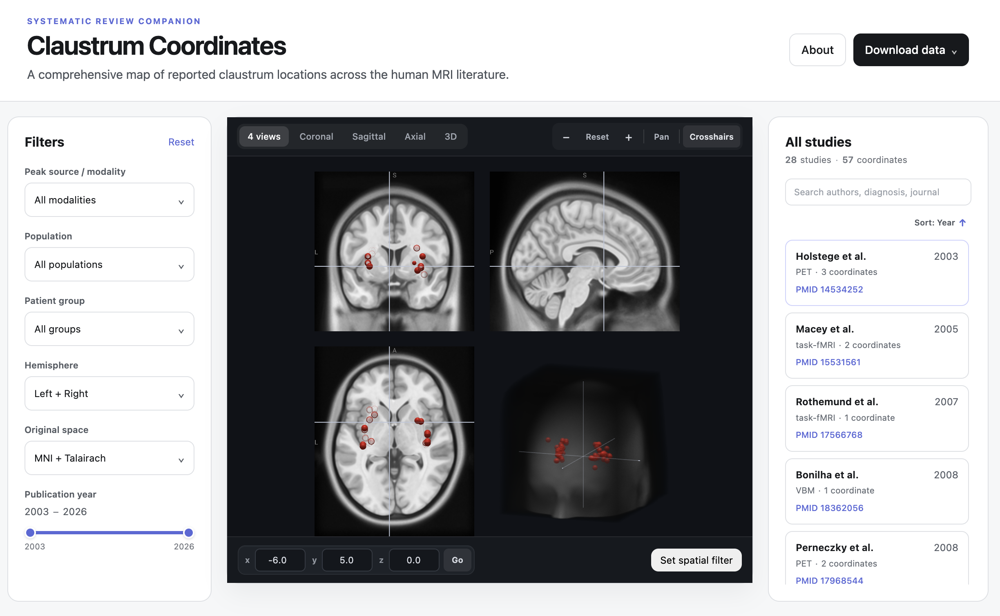

## About this repository

This repository contains the source code for [Claustrum Coordinates](https://navonacalarco.github.io/claustrum-coordinates/), an interactive web resource for exploring stereotaxic coordinates reported across the human claustrum MRI literature. 



## Built with

The site is built with **React**, **TypeScript**, **Vite**, and **NiiVue**, and is deployed with **GitHub Pages**. Development was supported by AI-assisted coding tools, including **ChatGPT** and **Claude**.

## Contributions

Contributions to the codebase, including new features and interface improvements, are welcome via pull request. To work locally:

```bash
git clone https://github.com/navonacalarco/claustrum-coordinates.git
cd claustrum-coordinates
npm install
npm run dev
```

## Issues and corrections

Found an incorrect coordinate or a relevant study that may be missing? [Open an issue here.](https://github.com/navonacalarco/claustrum-coordinates/issues)

## Citation

If you use the web resource, please cite [Zenodo citation / DOI forthcoming]. For the accompanying systematic review, please cite [**Calarco et al., forthcoming.**]

## License

The website source code is released under the **MIT License**.

## Refresh review data

Export Table 1 as an Excel workbook, then run:

```bash
node scripts/refresh-review-data.mjs /path/to/table-1.xlsx
npm run build
node --test tests/*.test.mjs
```

The importer reads second-row headers in `All studies - MRI information` and `Peak reporting`. It exports only the three website classification fields to `public/data/peak-classifications.json`, keyed by existing published peak IDs. It does not export extraction notes, participant details, or additional coordinates. Missing headers, ambiguous matches, and incomplete labels stop the import before writing.

Filters allow any selected label within each dropdown and require matches across dropdowns. Age is a study-level cohort label; task domain is specific to the reported contrast. CSV downloads include all three classification fields. The viewer continues to show reported MNI coordinates; Talairach harmonization remains pending.
